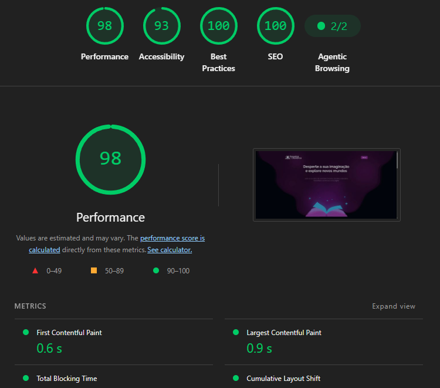
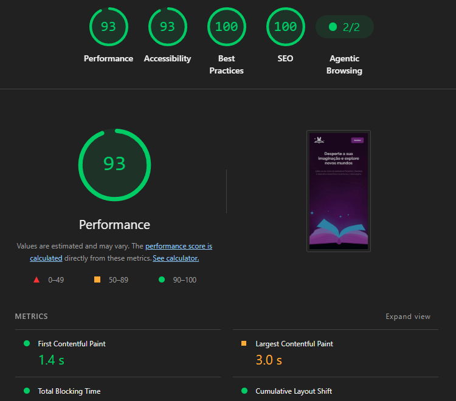

# 📚 Encantos Literários — Clube de Assinatura de Livros

Site completo de um clube de assinatura de livros, onde o usuário escolhe um plano e recebe mensalmente um kit com um livro surpresa do seu tema favorito, acompanhado de brindes exclusivos.

O projeto é composto por **7 páginas integradas** (início, pagamento, confirmação, biblioteca, perfil, clube de membros e "em breve"), construídas com **HTML, CSS e JavaScript puros** — sem frameworks e sem etapa de build.

> ⚠️ **Protótipo de front-end.** Não existe servidor, login ou cobrança real. O checkout é uma simulação e todos os dados ficam salvos apenas no navegador do usuário (`localStorage`).

## 📸 Preview

<!-- Vídeo do fluxo completo: ao editar no GitHub, arraste o .mp4 para esta linha -->

## 📊 Desempenho (Lighthouse)

Página inicial auditada com o Lighthouse do Chrome DevTools:

| Categoria | 💻 Desktop | 📱 Mobile |
|-----------|:----------:|:---------:|
| Performance | 98 | 93 |
| Acessibilidade | 93 | 93 |
| Boas práticas | 100 | 100 |
| SEO | 100 | 100 |

<table>
  <tr>
    <th>💻 Desktop</th>
    <th>📱 Mobile</th>
  </tr>
  <tr>
    <td></td>
    <td></td>
  </tr>
</table>

## 🚀 Demonstração

🔗 [Acessar o site](https://rochacode08.github.io/encantos-literarios/)

## 🛠️ Tecnologias utilizadas

- **HTML5** — estruturação semântica e multipágina
- **CSS3** moderno com:
  - **CSS Nesting nativo** (sem Sass/Less)
  - **Custom Properties** para cores, tipografia e espaçamentos
  - **Arquitetura modular** — um arquivo CSS por seção/página (14 no total)
  - **Grid & Flexbox** para os layouts
  - Media queries em `em` com sintaxe de intervalo (`width >= 48em`)
  - `prefers-reduced-motion` e foco visível para acessibilidade
- **JavaScript Vanilla (ES6+)** com:
  - Módulos em IIFE compartilhados entre páginas (`plans.js`, `storage.js`, `covers.js`)
  - `localStorage` e `sessionStorage` com leitura/escrita protegida por `try/catch`
  - Máscaras de input (cartão, validade, CVV) via regex
  - Busca, filtros e favoritos em tempo real
- **Node.js Test Runner** (`node --test`) — testes automatizados sem dependências
- **Open Library Covers API** — capas reais dos livros, com capa gerada de reserva
- **Google Fonts** — Raleway

## ✨ Funcionalidades

### 🏠 Página inicial
- ✅ Hero com apresentação do clube
- ✅ Seção animada destacando livro surpresa, brindes e experiência
- ✅ Vitrine do kit mensal com rótulos e setas apontando cada item
- ✅ Três planos de assinatura com preços e benefícios comparados

### 💳 Pagamento (simulação)
- ✅ Prévia visual do cartão atualizada em tempo real
- ✅ Máscaras automáticas de número, validade e CVV
- ✅ Validação de campos com mensagens de erro
- ✅ Resumo do pedido gerado a partir do plano escolhido
- ✅ Cartão de teste pré-definido para percorrer o fluxo

### 📖 Biblioteca
- ✅ Catálogo com 18 livros de exemplo
- ✅ Busca em tempo real por título, autor, gênero ou descrição, enquanto digita
- ✅ Filtro por 6 categorias (fantasia, romance, mistério, ficção, biografia, autoajuda)
- ✅ Favoritar livros com persistência no navegador
- ✅ Modal de detalhes com link para a página do livro na Open Library
- ✅ Capas carregadas da Open Library com fallback em gradiente + título

### 👤 Perfil
- ✅ Navegação em abas: dados pessoais, assinatura, preferências e histórico
- ✅ Upload de foto de perfil (até 1 MB)
- ✅ Endereço de entrega e método de pagamento (só os 4 últimos dígitos)
- ✅ Preferências de gênero e notificações
- ✅ Histórico de leituras com sistema de avaliação
- ✅ Botão para apagar todos os dados salvos

### 🎟️ Clube de membros
- ✅ Seis cards de benefícios exclusivos
- ✅ Agenda de eventos (encontro com autor, clube de leitura, workshop)
- ✅ Depoimentos de membros e chamada para assinatura

### ♿ Acessibilidade
- ✅ `prefers-reduced-motion` respeitado em todas as animações
- ✅ Classe `.visually-hidden` para leitores de tela
- ✅ Foco visível para navegação por teclado
- ✅ `alt` descritivo em imagens com significado

## 🎨 Paleta de cores

| Cor | Nome | Hex |
|-----|------|-----|
| 🟣 | Pink Light | `#C59DD2` |
| 🟣 | Pink Base | `#9547A5` |
| 🟣 | Pink Dark | `#7D298A` |
| 🟣 | Pink Low | `#3F0F41` |
| 🔵 | Blue Light | `#73B6D2` |
| 🔵 | Blue Base | `#358BB9` |
| 🔵 | Blue Mid | `#2374A4` |
| 🔵 | Blue Dark | `#144A72` |
| 🔵 | Blue Low | `#08233C` |
| ⬛ | Shape Stroke | `#002347` |
| ⬛ | Shape Base | `#000F1F` |
| ⬛ | Shape Background | `#00050A` |
| ⬜ | Text Title | `#F8FBFB` |
| ⬜ | Text Body | `#E2E7E9` |
| ⬜ | Text Label | `#BAC6C9` |

## 💰 Planos de assinatura

Os preços ficam **somente** em `js/plans.js` — todas as páginas leem dessa tabela única.

| Plano | Por mês | Período mínimo | Total do período |
|-------|---------|----------------|------------------|
| Mensal | R$ 59,90 | 1 mês | R$ 59,90 |
| Semestral | R$ 52,90 | 6 meses | R$ 317,40 |
| Anual | R$ 48,90 | 12 meses | R$ 586,80 |

> ⚠️ Ao alterar um preço, atualize também o texto dos cards no `index.html`. O `npm test` avisa se os valores ficarem diferentes.

## 💾 O que fica salvo no navegador

Todas as chaves usam o prefixo `encantos:`.

| Chave | Onde | Conteúdo |
|-------|------|----------|
| `profile`, `address` | local | Dados pessoais e endereço |
| `avatar` | local | Foto de perfil (JPG/PNG/WebP, até 1 MB) |
| `preferences` | local | Gêneros e notificações |
| `ratings`, `favorites` | local | Avaliações do histórico e livros favoritos |
| `subscription` | local | Plano, status, data de início e os 4 últimos dígitos do cartão |
| `selectedPlanId`, `lastCheckout` | sessão | Id do plano entre as páginas de plano → pagamento → confirmação |

> 🔒 Número completo de cartão, CVV e senhas **nunca** são armazenados.

## 📐 Responsividade

O projeto usa **mobile-first** com breakpoints em `48em` (768px) e `64em` (1024px). Foi testado de 320px a 1440px, sem rolagem lateral.

| Dispositivo | Largura | Principais ajustes |
|-------------|---------|--------------------|
| 📱 Mobile | até 767px | Container de 22.18rem, logo em símbolo, planos em carrossel (um card por vez), abas do perfil em grade 2×2, catálogo em lista com botões embaixo da capa |
| 📲 Tablet | 768px a 1023px | Container de 70rem, kit mensal com rótulos e setas em escala reduzida, planos em carrossel com cards de até 460px |
| 💻 Desktop | a partir de 1024px | Kit mensal em tamanho real, planos em leque (Mensal e Anual saem de trás do Semestral), tipografia maior |

## 📂 Estrutura do projeto

```
📦 encantos-literarios
 ┣ 📂 assets
 ┃ ┣ 📂 icons                        → Ícones SVG, favicons e licenças
 ┃ ┗ 🖼️ *.webp / *.png                → Imagens do kit e dos elementos místicos
 ┣ 📂 docs                           → Imagens usadas neste README
 ┣ 📂 css
 ┃ ┣ 📜 index.css                     → CSS da página inicial (importa as seções via @import)
 ┃ ┣ 📜 global.css                    → Reset, variáveis e acessibilidade
 ┃ ┣ 📜 utilitys.css                  → Container e utilitários
 ┃ ┣ 📜 hero.css                      → Hero da página inicial
 ┃ ┣ 📜 book-experience.css           → Seção animada de texto
 ┃ ┣ 📜 month-kit.css                 → Vitrine do kit mensal
 ┃ ┣ 📜 signature.css                 → Cards de planos
 ┃ ┣ 📜 payment.css                   → Página de pagamento
 ┃ ┣ 📜 library.css                   → Biblioteca
 ┃ ┣ 📜 profile.css                   → Perfil
 ┃ ┣ 📜 club.css                      → Clube de membros
 ┃ ┣ 📜 em-breve.css                  → Página "Em breve"
 ┃ ┗ 📜 footer.css                    → Rodapé compartilhado
 ┣ 📂 js
 ┃ ┣ 📜 plans.js                      → Tabela única de planos e preços
 ┃ ┣ 📜 storage.js                    → Leitura/gravação segura no storage
 ┃ ┣ 📜 covers.js                     → Capas da Open Library + fallback
 ┃ ┣ 📜 script.js                     → Página inicial
 ┃ ┣ 📜 payment.js                    → Pagamento
 ┃ ┣ 📜 success.js                    → Confirmação
 ┃ ┣ 📜 library.js                    → Catálogo, busca, filtros e favoritos
 ┃ ┣ 📜 profile.js                    → Abas, upload e persistência do perfil
 ┃ ┣ 📜 club.js                       → Clube de membros
 ┃ ┗ 📜 em-breve.js                   → Textos da página "Em breve"
 ┣ 📂 tests
 ┃ ┣ 📜 plans.test.js                 → Preços e regras dos planos
 ┃ ┗ 📜 assets.test.js                → Verifica se todo arquivo referenciado existe
 ┣ 📜 index.html                       → Página inicial e planos
 ┣ 📜 payment.html                     → Pagamento (simulação)
 ┣ 📜 success.html                     → Confirmação
 ┣ 📜 library.html                     → Biblioteca
 ┣ 📜 profile.html                     → Perfil
 ┣ 📜 club.html                        → Clube de membros
 ┣ 📜 em-breve.html                    → Página "Em breve" dos itens do rodapé
 ┗ 📜 package.json                     → Script de testes
```

## 💻 Como rodar o projeto

Clone o repositório:

```bash
git clone https://github.com/rochacode08/encantos-literarios.git
```

Acesse a pasta do projeto:

```bash
cd encantos-literarios
```

Abra o arquivo `index.html` no navegador — ou utilize a extensão **Live Server** do VS Code para recarregamento automático.

> ✅ Sem build step, sem `npm install`. É HTML/CSS/JS puro rodando direto no navegador.

### 🔄 Percorrendo o fluxo completo

**Início → Assinar um plano → Pagamento → Preencher com o cartão de teste → Simular pagamento → Biblioteca / Perfil**

Cartão de teste disponível na página de pagamento:

```
Número:   4111 1111 1111 1111
Nome:     TESTE USUARIO
Validade: 12/28
CVV:      123
```

## 🧪 Testes

Requer **Node.js 18+**. Não há dependências para instalar.

```bash
npm test
```

Os testes verificam:

- Formatação de preços e regras dos planos (`tests/plans.test.js`)
- Se os preços exibidos na página inicial batem com a tabela de `plans.js`
- Se todo arquivo local referenciado em HTML, CSS e JS realmente existe (`tests/assets.test.js`)

## 📚 O que foi trabalhado

### 🏗️ Arquitetura
- **Fonte única de verdade** para os planos (`plans.js`), consumida por todas as páginas
- **Módulos em IIFE** compatíveis tanto com o navegador quanto com o Node (para os testes)
- **CSS modular** com um arquivo por seção/página: a página inicial reúne suas seções no `index.css` via `@import`, e as demais páginas carregam seus arquivos com `<link>`
- Projeto multipágina com rodapé e estilos globais compartilhados

### 💾 Persistência de dados
- Camada de abstração sobre `localStorage` e `sessionStorage` com `try/catch` em todas as operações
- Prefixo de namespace (`encantos:`) para isolar os dados do protótipo
- Função de limpeza total acionada pelo botão "Apagar dados salvos"
- Decisão consciente de nunca armazenar dados sensíveis de cartão

### 🎨 Interface e interação
- Máscaras de input com regex para cartão, validade e CVV
- Prévia visual do cartão sincronizada com o formulário
- Busca e filtros combinados em tempo real na biblioteca
- Navegação em abas no perfil
- Upload de imagem com validação de tipo e tamanho

### 🌐 Integração externa
- Consumo da **Open Library Covers API** para as capas reais
- Fallback programático gerando uma capa em gradiente com título e autor quando a imagem não carrega
- Uso de `default=false` na API para forçar erro 404 e disparar o fallback

### 🧪 Qualidade
- Testes automatizados com o runner nativo do Node, sem dependências
- Teste de integridade que percorre HTML, CSS e JS validando todos os caminhos de arquivos
- Teste de consistência entre os preços do `plans.js` e o HTML

## ⚠️ Limitações conhecidas

- **Pagamento:** é uma simulação. Para cobrar de verdade seria necessário integrar um provedor, criar a cobrança no servidor e validar webhooks assinados.
- **Contas:** não há login; "Sair" apenas retorna à página inicial.
- **Persistência:** os dados existem apenas no navegador atual — outro dispositivo não verá as mesmas informações.
- **Biblioteca:** o catálogo tem 18 livros de exemplo e não há leitura no site.
- **Redes sociais:** os ícones do rodapé ainda não possuem endereço.
- **Rodapé:** Kits passados, Blog, Central de ajuda, Regulamentos e Suporte levam à página "Em breve".
- **Navegadores:** o CSS usa aninhamento nativo, suportado em Chrome/Edge 120+, Firefox 117+ e Safari 17.2+.

## 🔮 Melhorias futuras

- [ ] Integrar um provedor de pagamento real com validação no servidor
- [ ] Implementar autenticação e contas de usuário
- [ ] Migrar a persistência do `localStorage` para um backend
- [ ] Adicionar `og:image` nas prévias de compartilhamento
- [ ] Publicar as seções do rodapé (blog, central de ajuda, regulamentos)
- [ ] Expandir o catálogo da biblioteca e adicionar paginação
- [ ] Criar fluxo de cancelamento e troca de plano no perfil

## 📄 Créditos e Licença

Projeto desenvolvido para **fins educacionais e de estudo**.

- **Ícones** `edit` e `credit-card`: [Lucide](https://lucide.dev) — licença ISC (ver `assets/icons/LICENSE-lucide.txt`)
- **Ícones** `books`, `heart`, `bookmarks` e `camera-plus`: [Phosphor Icons](https://phosphoricons.com) — licença MIT (ver `assets/icons/LICENSE-phosphor.txt`)
- **Capas dos livros:** [Open Library Covers API](https://openlibrary.org/dev/docs/api/covers) — as capas pertencem às respectivas editoras e autores
- **Fonte:** Raleway, via Google Fonts (SIL Open Font License)
- **Favicon:** criado a partir do logo do projeto

---

## 👨‍💻 Autor
Desenvolvido com 💙 por **[Gabriel Rocha Lopes](https://github.com/rochacode08)**

<a href="mailto:gabrielrocha.devstack@gmail.com">
    
</a>
<a href="https://www.linkedin.com/in/gabriel-rocha-devstack">
    
</a>
<a href="https://www.instagram.com/gabriel_lopess15/">
    
</a>

---